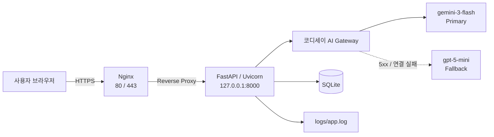
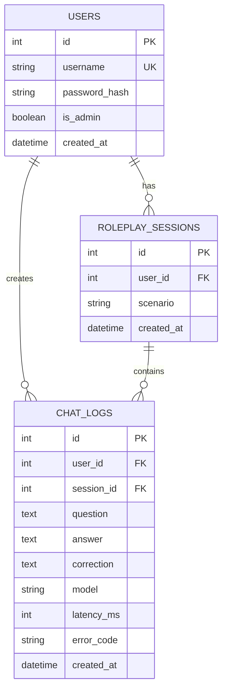

# Cody — 영어 회화 롤플레이 파트너

상황을 고르면 AI가 상대역을 연기하고, 어색한 표현이 나오면 한국어로 교정해 주는 웹 챗봇 서비스입니다.

연습 기록은 사용자별로 저장되며, 지난 대화와 교정 기록을 다시 확인할 수 있습니다.

---

## 1. 프로젝트 개요

### 문제 정의

영어 회화는 실제로 말을 주고받는 연습이 중요하지만, 반복해서 대화할 상대를 구하기는 어렵습니다.

혼자 하는 문법 학습만으로는 실제 발화 연습으로 이어지기 어렵다는 문제를 해결하기 위해 AI 기반 영어 회화 롤플레이 서비스를 구현했습니다.

### 타겟 사용자

말하기 연습 상대가 필요한 한국어 화자 영어 학습자

### 핵심 시나리오

1. 로그인 후 상황(카페·공항·쇼핑 등)을 선택한다.
2. 영어로 말을 걸면 AI가 해당 상황의 상대역으로 답한다.
3. 어색한 표현이 있으면 한국어 교정을 함께 제공한다.
4. 같은 세션에서는 이전 대화 문맥을 유지한다.
5. 지난 대화와 교정 이력을 다시 확인할 수 있다.

---

## 2. 시스템 구조



운영 환경에서는 외부 요청을 Nginx가 받은 뒤 내부의 FastAPI 애플리케이션으로 전달합니다.

FastAPI 애플리케이션은 서버 내부에서 다음 주소로 실행됩니다.

```text
127.0.0.1:8000
```

AI 호출은 코디세이 게이트웨이의 OpenAI 호환 엔드포인트를 사용합니다.

```text
/v1/chat/completions
```

`openai` SDK에 `base_url`을 코디세이 게이트웨이 주소로 지정하여 사용합니다.

### 모델 선택

게이트웨이를 실제 호출해 확인한 제약은 다음과 같습니다.

| 확인한 것 | 결과 |
|---|---|
| Anthropic 계열 (`claude-*`) | OpenAI 호환 키로는 호출되지 않음. Anthropic 방식 키와 `/v1/messages`가 별도로 필요 |
| GPT-5 계열 (`gpt-5*`) | 기본값 외 `temperature`를 거부하므로 해당 파라미터를 제외하여 호출 |

주 모델은 `gemini-3-flash`, 폴백 모델은 다른 공급사의 `gpt-5-mini`를 사용합니다.

폴백은 주 모델이 **429·5xx 또는 연결 실패**인 경우에만 동작합니다.

타임아웃이 발생한 경우에는 이미 기다린 사용자에게 다시 긴 대기 시간을 주지 않기 위해 폴백하지 않고 `AI_TIMEOUT` 오류(HTTP 504)를 반환합니다.

| 정책 | 값 |
|---|---|
| Timeout | `AI_TIMEOUT` (기본 30초). 넘으면 바로 504 안내 |
| Retry | SDK 자동 재시도는 끔(`max_retries=0`). 켜 두면 타임아웃도 한 번 더 기다려 최대 대기가 두 배가 됨 |
| Fallback | 429·5xx·연결 실패일 때 보조 모델로 1회. 그것도 실패하면 503 + `Retry-After` |

### 주요 컴포넌트

| 컴포넌트 | 역할 |
|---|---|
| `app/main.py` | 앱 생성, 세션·요청 로깅 미들웨어, 예외 처리 |
| `app/routers/pages.py` | 화면 라우트 (연습·기록·교정·로그인·회원가입). 로그인 필요한 화면은 `get_current_user` 로 보호 |
| `app/routers/auth.py` | 회원가입 / 로그인 / 로그아웃 (폼 POST) |
| `app/routers/chat.py` | 챗 파이프라인 (`send_message`) |
| `app/routers/records.py` | 사용자별 대화 로그·세션·교정·통계 조회 |
| `app/routers/admin_logs.py` | 관리자 운영 로그 조회 API |
| `app/services/ai.py` | AI 응답 생성 (`generate_ai_reply`), 타임아웃·폴백 처리 |
| `app/services/context.py` | 프롬프트 메시지 구성 (`build_prompt_messages`) |
| `app/security.py` | 아이디·비밀번호 정책, 비밀번호 해싱 |
| `app/deps.py` | 사용자 및 관리자 인증 의존성 |
| `app/logging_config.py` | 콘솔·파일 로그, request_id 부착, Rotation 설정 |
| `app/log_events.py` | 로그 이벤트 이름 목록 |
| `app/models.py` | DB 모델 |
| `app/config.py` | 환경변수 기반 설정 |

**API 키는 서버에만 존재합니다.**

브라우저는 서버의 API만 호출하며 AI API Key를 직접 사용하지 않습니다.

---

## 3. API 명세

### `POST /api/chat` — 대화

로그인이 필요합니다.

요청 예시:

```json
{
  "message": "I want coffee",
  "scenario": "cafe",
  "session_id": null
}
```

`session_id`가 `null`이면 새 롤플레이 세션을 생성합니다.

응답으로 받은 `session_id`를 다음 요청에 전달하면 같은 세션의 대화 문맥을 이어갈 수 있습니다.

응답 예시:

```json
{
  "session_id": 12,
  "chat_id": 87,
  "saved": true,
  "scenario": "cafe",
  "reply": "Sure! What size would you like?",
  "correction": "\"I want coffee\" 보다 \"Could I get a coffee?\" 가 자연스러워요."
}
```

대화 기록 저장에 실패해도 AI 응답은 그대로 돌려주며, 이때 `saved`는 `false`, `chat_id`는 `null`입니다.

AI 호출이 시간 초과되면 HTTP `504`, 그 밖의 AI 장애는 HTTP `503`(`Retry-After` 헤더 포함)을 반환합니다.

```json
{
  "error": "AI_TIMEOUT",
  "message": "현재 응답이 지연되고 있어요. 잠시 후 다시 시도해 주세요."
}
```

| 에러 코드 | 상황 |
|---|---|
| `AI_TIMEOUT` | AI 게이트웨이 응답 지연 |
| `AI_ERROR` | AI 호출 실패 또는 빈 응답 |
| `INVALID_INPUT` | 입력 검증 실패 (빈 메시지, 최대 길이 초과, 지원하지 않는 시나리오) |
| `INTERNAL_ERROR` | 그 외 서버 내부 오류 |

### 오류 응답 형식과 상태코드

모든 오류 응답은 같은 형식입니다. 화면은 `message`를 그대로 보여주고, `error`는 로그와 통계에서 원인을 구분할 때 씁니다.

```json
{ "error": "INVALID_INPUT", "message": "메시지는 1000자를 넘을 수 없습니다." }
```

| 상태코드 | `error` | 언제 |
|---|---|---|
| 200 | - | 성공 |
| 303 | - | 화면 이동 (로그인·회원가입 성공, 로그아웃, 비로그인 브라우저의 화면 요청) |
| 401 | `UNAUTHORIZED` | 로그인하지 않은 API 요청. 로그인 폼에서는 아이디·비밀번호 불일치 |
| 403 | `FORBIDDEN` | 관리자 전용 API 를 일반 사용자가 요청, 남의 세션으로 대화하거나 조회 |
| 404 | `NOT_FOUND` | 없는 세션 |
| 409 | - | 회원가입: 이미 있는 아이디, 예약된 아이디 (가입 화면에 안내) |
| 422 | `INVALID_INPUT` | 입력 검증 실패. 회원가입 폼에서는 아이디·비밀번호 정책 위반 |
| 500 | `INTERNAL_ERROR` | 예상하지 못한 서버 오류 |
| 503 | `AI_ERROR` | AI 게이트웨이 장애, 빈 응답 (`Retry-After` 헤더 포함) |
| 504 | `AI_TIMEOUT` | AI 응답 시간 초과 |

회원가입·로그인은 HTML 폼이라, 실패하면 JSON 대신 해당 화면을 위 상태코드와 함께 다시 보여줍니다. 성공하면 303으로 이동합니다(새로고침해도 폼이 다시 전송되지 않게).

### 계정 정책

| 항목 | 규칙 |
|---|---|
| 아이디 | 영문 소문자·숫자·밑줄(`_`) 3~20자. 공백 제거, 유니코드 정규화(NFKC), 소문자 변환 후 저장·비교하므로 `Tester`, ` tester `, `ｔｅｓｔｅｒ`는 모두 같은 아이디 |
| 예약 아이디 | `admin`, `administrator`, `root`, `system` 은 가입 불가 (관리자 권한은 `is_admin` 으로만 부여) |
| 비밀번호 | 8자 이상, 72바이트 이하, 영문자와 숫자를 각각 1개 이상, 공백 불가, 아이디 포함 불가 |
| 비교 방식 | bcrypt 는 72바이트까지만 보므로, 잘라서 비교하지 않고 72바이트를 넘는 입력은 거부 (앞부분만 같은 다른 비밀번호로 로그인되는 것을 막음) |
| 로그인 실패 | 없는 아이디와 틀린 비밀번호를 같은 문구와 비슷한 응답 시간으로 안내 (가입 여부를 알 수 없게) |
| 기존 계정 | 규칙이 생기기 전에 가입한 계정은 원래 아이디 그대로 로그인됩니다. `Tester`와 `tester`가 따로 있어도 각자 로그인되고, 입력과 정확히 같은 아이디가 없을 때만 대소문자를 무시하고 찾습니다 |

### 배포 전에 열어 둔 화면과의 호환

배포 직후에도 사용자의 브라우저에는 이전 버전 화면이 열려 있을 수 있습니다.

- 이전 화면이 부르는 요청은 당분간 그대로 지원합니다: `GET /api/me/chats?session_id=`, `GET /api/me/corrections/by-scenario`. 응답에 `Deprecation: true` 헤더가 붙고 `deprecated_api_called` 로그가 남습니다. 이 로그가 한동안 없으면 제거합니다.
- 모든 응답에 `X-App-Build`(배포된 커밋)를 붙입니다. 화면은 자기 빌드와 다르면 상단에 새로고침 안내를 띄웁니다.
- CSS 주소에 `?v=<빌드>`를 붙여, 배포 후 브라우저가 이전 CSS 캐시를 쓰지 않게 합니다.

---

### `GET /api/me/chats` — 내 대화 로그

로그인이 필요합니다.

```text
/api/me/chats?limit=50&offset=0
```

현재 로그인한 사용자의 대화 로그를 최신순으로 반환합니다. 추적용이라 AI 호출에 실패한 턴도 `error_code`, `latency_ms`와 함께 나옵니다. 세션 하나의 대화만 필요하면 `/api/me/sessions/{session_id}`를 씁니다.

---

### `GET /api/me/corrections` — 내 교정 기록

교정이 존재하는 대화만 조회합니다.

지원 파라미터:

```text
limit
offset
scenario
```

---

### `GET /api/me/sessions` — 내 세션 목록

현재 사용자의 롤플레이 세션 목록을 반환합니다.

각 세션에 대해 다음 정보를 확인할 수 있습니다.

- 대화 턴 수
- 교정 수
- 마지막 대화 시각

---

### `GET /api/me/sessions/{session_id}` — 세션 상세 조회

선택한 세션의 대화 기록 전체를 반환합니다. 기록 화면의 펼치기와 이어하기가 함께 씁니다.

다른 사용자의 세션을 요청하면 `403 Forbidden`, 없는 세션이면 `404 Not Found`를 반환합니다. 로그인은 했지만 권한이 없는 경우라 인증 실패(401)와 구분합니다.

---

### `GET /api/me/stats` — 학습 통계

현재 사용자의 학습 통계를 반환합니다.

- 총 세션 수
- 총 대화 턴 수
- 총 교정 수
- 오류 수
- 평균 AI 응답 시간 (운영 지표. 학습자 화면에는 표시하지 않음)
- 상황별 교정 횟수 (`corrections_by_scenario`, 교정 화면의 필터에 사용)

---

### `GET /api/admin/logs` — 관리자 운영 로그

관리자 전용 API입니다.

최근 운영 로그를 지정한 개수만큼 조회합니다.

```text
/api/admin/logs?limit=100
```

접근 권한:

```text
비로그인 사용자 → 401
일반 사용자     → 403
관리자          → 200
```

관리자 여부는 `users` 테이블의 `is_admin` 필드를 기준으로 판단합니다.

---

### `GET /health` — 상태 확인

```json
{
  "status": "ok"
}
```

---

## 4. DB 구조

SQLite를 사용하며 기본 DB 파일은 다음 위치에 저장됩니다.

```text
data/chatbot.db
```

### ERD



### `users`

사용자 계정 정보를 저장합니다.

| 필드 | 설명 |
|---|---|
| `id` | 사용자 PK |
| `username` | 로그인 사용자명 |
| `password_hash` | 해시된 비밀번호 |
| `is_admin` | 관리자 여부. 기본값은 `false` |
| `created_at` | 사용자 생성 시각 |

### `roleplay_sessions`

롤플레이 한 번의 세션을 저장합니다.

세션을 별도로 두는 이유는 **대화 문맥을 롤플레이 단위로 분리하기 위해서**입니다.

예를 들어 카페 대화를 하다가 공항 롤플레이를 새로 시작하면 카페에서 했던 대화가 새로운 문맥에 포함되지 않습니다.

| 필드 | 설명 |
|---|---|
| `id` | 세션 PK |
| `user_id` | 사용자 FK |
| `scenario` | 롤플레이 상황 |
| `created_at` | 세션 생성 시각 |

### `chat_logs`

사용자와 AI 사이의 대화 한 턴을 저장합니다.

| 필드 | 설명 |
|---|---|
| `id` | 로그 PK |
| `user_id` | 사용자 FK |
| `session_id` | 세션 FK |
| `question` | 사용자 발화 |
| `answer` | AI 응답 |
| `correction` | 표현 교정 |
| `model` | 사용된 AI 모델 |
| `latency_ms` | AI 응답 소요 시간 |
| `error_code` | 오류 코드 |
| `created_at` | 대화 시각 |

---

## 5. DB 확인 가이드

SQLite CLI를 이용해 다음 명령을 실행합니다.

```bash
sqlite3 data/chatbot.db < scripts/check_logs.sql
```

다음 정보를 확인할 수 있습니다.

- 사용자 목록
- 최근 대화 20건
- 사용자별 누적 통계

웹에서는 다음 API로 현재 로그인 사용자의 기록을 확인할 수 있습니다.

```text
GET /api/me/chats
```

---

## 6. 실행 방법

### Python

Python 3.12 이상이 필요합니다.

### 가상환경 생성

```bash
python -m venv .venv
```

Linux / macOS:

```bash
source .venv/bin/activate
```

Windows:

```powershell
.\.venv\Scripts\activate
```

### 패키지 설치

```bash
python -m pip install -r requirements.txt
```

### 환경변수 설정

```bash
cp .env.example .env
```

Windows PowerShell:

```powershell
Copy-Item .env.example .env
```

필요한 값을 `.env`에 입력합니다.

### 서버 실행

```bash
uvicorn app.main:app --reload
```

로컬 접속 주소:

```text
http://127.0.0.1:8000
```

`AI_MOCK=true`로 설정하면 실제 AI API를 호출하지 않고 테스트할 수 있습니다.

---

## 7. 환경 변수

| 키 | 설명 |
|---|---|
| `AI_API_KEY` | 코디세이 콘솔에서 발급한 AI API Key |
| `AI_BASE_URL` | 코디세이 AI Gateway 기본 URL |
| `AI_MODEL` | 주 AI 모델 |
| `AI_FALLBACK_MODEL` | 주 모델 실패 시 사용할 보조 모델 |
| `AI_TEMPERATURE` | 응답 생성 다양성 설정 |
| `AI_TIMEOUT` | AI 요청 제한 시간(초) |
| `AI_MAX_CONTEXT_TURNS` | 문맥에 포함할 최근 대화 턴 수 |
| `AI_MOCK` | `true`이면 실제 AI 호출 없이 Mock 응답 사용 |
| `SESSION_SECRET_KEY` | 로그인 세션 서명 키 |
| `DATABASE_URL` | DB 연결 주소 |
| `LOG_LEVEL` | 애플리케이션 로그 레벨 |
| `LOG_UTC_OFFSET_HOURS` | 로그 시각의 시간대 (UTC 기준 시차, 기본 9 = 한국 시간) |
| `MAX_MESSAGE_LENGTH` | 사용자 입력 최대 길이 |

기본 DB:

```env
DATABASE_URL=sqlite:///./data/chatbot.db
```

실제 API Key와 Secret 값은 `.env`에만 저장하며 Git 저장소에 포함하지 않습니다.

---

## 8. 테스트 및 코드 품질

전체 테스트:

```bash
pytest -q
```

Ruff 검사:

```bash
ruff check .
```

자동 수정 가능한 Ruff 오류 수정:

```bash
ruff check --fix .
```

---

## 9. 운영 로그

### 형식

```text
INFO  2026-10-29T14:02:11+09:00 cody.request request_id=3f9a1c2b7d10 request_received user_id=4 method=POST path=/api/chat
INFO  2026-10-29T14:02:11+09:00 cody.ai      request_id=3f9a1c2b7d10 ai_call_start model=gemini-3-flash turns=7 mock=False
INFO  2026-10-29T14:02:13+09:00 cody.ai      request_id=3f9a1c2b7d10 ai_call_success latency_ms=1840
INFO  2026-10-29T14:02:13+09:00 cody.db      request_id=3f9a1c2b7d10 db_save_success user_id=4 chat_id=87
INFO  2026-10-29T14:02:13+09:00 cody.request request_id=3f9a1c2b7d10 request_done path=/api/chat status=200 took_ms=1863
```

- **request_id**: 요청마다 하나씩 만들어 그 요청 안의 모든 로그 줄에 붙입니다. 응답 헤더 `X-Request-ID`로도 내려주므로, 오류가 난 요청의 id 로 `grep` 하면 요청 → AI 호출 → DB 저장 흐름을 한 번에 볼 수 있습니다.
- **로거 이름으로 분야 구분**: `cody.request`(요청), `cody.auth`(인증), `cody.ai`(AI 호출), `cody.db`(대화 저장). 예: `grep " cody.ai " logs/app.log`
- **이벤트 이름**은 `app/log_events.py` 한 곳에 모아 둡니다.
- **시각**에는 시간대를 붙입니다(`+09:00`). 서버 시계는 UTC 라서 시간대 없이 찍으면 한국 시간 오후 4시 요청이 `07:00`으로 보여 찾기 어렵습니다. `.env`의 `LOG_UTC_OFFSET_HOURS`로 바꿀 수 있습니다.

### 이벤트

| 로거 | 이벤트 | 레벨 |
|---|---|---|
| `cody.app` | `app_started`, `app_stopped` | INFO |
| `cody.request` | `request_received`, `request_done`, `deprecated_api_called` | INFO |
| `cody.request` | `unhandled_error` (스택트레이스 포함) | ERROR |
| `cody.auth` | `signup_success`, `signup_failed`, `login_success`, `login_failed`, `logout`, `stale_session_cleared` | INFO |
| `cody.ai` | `ai_call_start`, `ai_call_success`, `ai_fallback_start` | INFO |
| `cody.ai` | `ai_call_failed`, `ai_response_malformed` | WARNING |
| `cody.db` | `db_save_success` | INFO |
| `cody.db` | `db_save_failed` (스택트레이스 포함) | ERROR |

비밀번호, API 키, 대화 내용은 로그에 남기지 않습니다. 인증 로그에도 아이디 대신 user_id 만 남깁니다.

로그는 콘솔과 파일에 함께 기록됩니다.

```text
logs/app.log
```

### 로그 Rotation

`RotatingFileHandler`를 사용하여 로그 파일이 무한히 커지는 것을 방지합니다.

현재 설정:

```text
로그 파일 최대 크기: 5 MB
백업 파일: 최대 5개
```

예:

```text
logs/
├── app.log
├── app.log.1
├── app.log.2
├── app.log.3
├── app.log.4
└── app.log.5
```

`logs/`는 `.gitignore`를 통해 저장소에서 제외합니다.

---

## 10. DB 백업 및 복구

### 데이터 영속성

로그와 DB 는 모두 VM 디스크에 파일로 저장되므로 서버를 재시작하거나 VM 을 껐다 켜도 남아 있습니다. 배포 스크립트도 `data/`, `logs/`를 건드리지 않습니다.

| 위치 | 내용 |
|---|---|
| `data/chatbot.db` | 사용자, 세션, 대화 기록 |
| `data/chatbot.db-wal` | 아직 본 파일에 옮겨지지 않은 최근 변경 (SQLite WAL) |
| `logs/app.log` (+ `app.log.1~5`) | 운영 로그 |
| `journalctl -u cody.service` | 같은 운영 로그 (systemd) |

SQLite WAL 모드에서는 커밋된 데이터가 먼저 `chatbot.db-wal`에 쌓이고, 일정량이 차야 `chatbot.db`로 옮겨집니다. 사용량이 적으면 몇 주 동안 본 파일이 갱신되지 않아서, **`chatbot.db`만 복사하거나 내려받으면 최근 데이터가 빠집니다.** (실제로 운영 서버의 본 파일이 9월 12일 이후 갱신되지 않고, 이후 데이터가 모두 WAL 에만 있었습니다.) 그래서 다음처럼 처리합니다.

- 앱이 시작하고 종료할 때 WAL 을 본 파일로 옮깁니다(`checkpoint_wal`). 배포·재시작 때마다 본 파일이 최신이 됩니다.
- WAL 이 약 400KB(100페이지) 쌓이면 자동으로 옮깁니다. SQLite 기본값은 약 4MB입니다.
- `synchronous=FULL`로 커밋마다 디스크에 기록합니다. 응답이 나간 데이터는 전원이 나가도 남습니다.
- 백업과 복구는 파일 복사가 아니라 SQLite 백업 API 로 합니다(WAL 내용 포함).

### 백업

```bash
python scripts/backup_db.py
```

서버가 돌고 있는 중에도 실행할 수 있습니다. WAL 에만 있는 최근 데이터까지 포함합니다.

백업 파일은 다음 형식으로 생성됩니다.

```text
backups/chatbot_YYYYMMDD_HHMMSS.db
```

### 복구

서비스를 멈춘 뒤 실행합니다. `chatbot.db`를 파일째 덮어쓰면 남아 있던 옛 WAL 이 새 파일에 적용되어 DB 가 깨질 수 있어서, 백업 API 로 내용을 옮깁니다.

```bash
sudo systemctl stop cody.service
./.venv/bin/python scripts/restore_db.py backups/<백업파일명>.db
sudo systemctl start cody.service
```

기존 DB를 바로 덮어쓰지 않도록 복구 직전에 현재 DB를 한 번 더 백업합니다.

```text
backups/pre_restore_YYYYMMDD_HHMMSS.db
```

### DB 무결성 확인

```bash
python -c "import sqlite3; conn=sqlite3.connect('data/chatbot.db'); print(conn.execute('PRAGMA integrity_check;').fetchone()[0]); conn.close()"
```

정상 결과:

```text
ok
```

실제 DB 파일과 백업 파일은 Git 저장소에 포함하지 않습니다.

---

## 11. DB Migration

기존 운영 DB에 새로운 컬럼을 추가해야 하는 경우 기존 데이터를 유지하기 위해 migration 스크립트를 사용합니다.

현재 `users` 테이블의 `is_admin` 컬럼 추가를 위한 스크립트:

```bash
python scripts/migrate_add_is_admin.py
```

운영 서버에서는 다음과 같이 실행할 수 있습니다.

```bash
./.venv/bin/python scripts/migrate_add_is_admin.py
```

스크립트는 먼저 `users` 테이블의 컬럼을 확인합니다.

`is_admin` 컬럼이 이미 존재하면 아무 작업도 수행하지 않으므로 반복 실행해도 기존 컬럼을 다시 추가하지 않습니다.

기존 사용자는 migration 이후에도 일반 사용자 상태인 `is_admin=false`를 유지합니다.

---

## 12. 운영 서버 및 배포

운영 서버는 Ubuntu 기반 Azure VM을 사용합니다.

프로젝트 위치:

```text
/home/azureuser/cody_chatbot
```

FastAPI 애플리케이션은 systemd 서비스로 관리합니다.

```text
cody.service
```

서비스 상태 확인:

```bash
sudo systemctl status cody.service
```

재시작:

```bash
sudo systemctl restart cody.service
```

저장소에는 서버 재구성을 위한 설정 파일을 함께 관리합니다.

```text
deploy/
├── cody.service
├── nginx.conf
└── README.md
```

---

## 13. Nginx 및 HTTPS

Nginx가 외부 요청을 받고 FastAPI로 전달합니다.

```text
사용자
  ↓
HTTP :80 / HTTPS :443
  ↓
Nginx
  ↓
127.0.0.1:8000
  ↓
FastAPI
```

운영 서비스 주소:

```text
https://cody-chatbot.koreacentral.cloudapp.azure.com
```

HTTP 요청은 HTTPS로 리다이렉트됩니다.

Let's Encrypt와 Certbot을 이용해 HTTPS 인증서를 관리합니다.

### 인증서 자동 갱신 확인

```bash
sudo systemctl status certbot.timer --no-pager
```

갱신 테스트:

```bash
sudo certbot renew --dry-run
```

새 서버에서는 인증서 파일이 먼저 존재해야 하므로 **Certbot으로 인증서를 발급한 뒤 HTTPS nginx 설정을 적용**해야 합니다.

상세 절차:

```text
deploy/README.md
```

---

## 14. GitHub Actions 자동 배포

`develop` 브랜치에 변경사항이 Merge되면 GitHub Actions가 자동으로 운영 서버에 배포합니다.


자동 배포 과정:

1. GitHub Actions 실행
2. SSH로 Azure VM 접속
3. `develop` 브랜치 최신 코드 가져오기
4. `requirements.txt` 의존성 설치
5. 기존 SQLite DB에 `is_admin` 컬럼이 필요한 경우 migration 실행
6. `cody.service` 재시작
7. 서비스 활성 상태 확인

기존 운영 DB와의 호환성을 위해 배포 과정에서 다음 migration을 실행합니다.

```bash
./.venv/bin/python scripts/migrate_add_is_admin.py
```

해당 스크립트는 `is_admin` 컬럼이 이미 존재하면 아무 작업도 하지 않도록 구현되어 있어 반복 배포에도 사용할 수 있습니다.

GitHub Actions에서 사용하는 서버 정보는 GitHub Secrets에 저장합니다.

```text
SERVER_HOST
SERVER_USER
SSH_PRIVATE_KEY
```

SSH Private Key는 코드나 저장소에 포함하지 않습니다.

---

## 15. 보안 및 접근 제어

### 사용자 인증

회원가입 시 비밀번호는 평문으로 저장하지 않고 bcrypt 해시 형태로 저장합니다.

로그인에 성공하면 세션에 사용자 ID를 저장하고, 이후 인증이 필요한 기능에서는 해당 세션을 기준으로 사용자를 확인합니다.

비로그인 사용자가 메인 화면에 접근하면 `/login`으로 이동합니다.

개발 단계에서 사용했던 인증 우회 기능은 제거했으며, 현재는 실제 로그인 세션만 사용합니다.

### 예약 관리자 아이디

`admin` 사용자명은 일반 사용자가 회원가입으로 선점하지 못하도록 예약 아이디로 차단합니다.

대소문자를 변경한 다음 사용자명도 차단합니다.

예:

```text
admin
Admin
ADMIN
```

단, 사용자명이 관리자 권한을 결정하지는 않습니다.

실제 관리자 권한은 `users.is_admin` 필드를 기준으로 판단합니다.

### 사용자 데이터

사용자 기록 API의 모든 조회는 현재 로그인한 사용자의 ID를 기준으로 제한합니다.

예:

```text
ChatLog.user_id == 현재 로그인 사용자의 ID
```

따라서 다른 사용자의 대화 기록이나 교정 기록을 조회할 수 없습니다.

### 관리자 API

관리자 운영 로그 API는 `users` 테이블의 `is_admin` 필드를 기준으로 접근을 제한하며, `is_admin=true`인 사용자만 접근할 수 있습니다.

일반 회원가입으로 생성된 사용자의 `is_admin` 기본값은 `false`입니다.

관리자 권한을 부여하려면 운영 서버에서 다음 명령을 실행합니다.

```bash
./.venv/bin/python -m scripts.set_admin <username> true
```

예:

```bash
./.venv/bin/python -m scripts.set_admin codyadmin true
```

관리자 권한을 해제하려면 다음과 같이 실행합니다.

```bash
./.venv/bin/python -m scripts.set_admin <username> false
```

관리자 로그 API:

```text
GET /api/admin/logs
```

권한에 따른 응답:

```text
비로그인 → 401 Unauthorized
일반 사용자 → 403 Forbidden
관리자 → 200 OK
```

### 저장소에 포함하지 않는 정보

다음 정보는 Git에 저장하지 않습니다.

```text
.env
API Key
SESSION_SECRET_KEY
SSH Private Key
실제 SQLite DB
DB 백업 파일
운영 로그 파일
Let's Encrypt Private Key
```

---

## 16. 팀 구성원 역할

프로젝트는 초기에는 A/B/C 3인 체제로 역할을 분담했으나, 진행 중 B가 이탈하여 남은 작업을 A와 C가 분담했습니다.

최종 역할은 실제 구현 내용과 Git 이력을 기준으로 정리했습니다.

| 구분 | 담당 | 범위 |
|---|---|---|
| A | 인프라 · DB · 배포 · 인증 | DB 스키마, SQLite 운영, Azure VM, Nginx/systemd, GitHub Actions 자동 배포, HTTPS, 운영 로그 파일, 로그 Rotation, DB 백업·복구, DB migration, 회원가입·로그인·로그아웃, 로그인 접근 제어, 로그인·회원가입 화면 연결, 관리자 `is_admin` 권한, 관리자 설정 스크립트, 관리자 운영 로그 API, ERD 및 운영·배포 문서 |
| C | AI 파이프라인 · 대화 기능 · 운영 | AI Gateway 연동, 주 모델 및 fallback 처리, 대화 문맥 유지, 챗 파이프라인, 사용자 대화 로그 저장·조회, 교정 기록, 세션 조회, 학습 통계, AI 오류 처리 및 관련 운영 기능 |

트랙별 세부 내용은 [`docs/HANDOFF.md`](docs/HANDOFF.md)를 참고합니다.

---

## 17. 협업 규칙

브랜치 구조:

```text
main
develop
feat/*
chore/*
docs/*
```

작업 흐름:

```text
Issue 생성
→ 작업 브랜치 생성
→ Commit / Push
→ Pull Request
→ 팀원 Review / Approve
→ CI 통과
→ develop Merge
```

- `main`, `develop`에 직접 Push하지 않습니다.
- 모든 변경사항은 Pull Request를 통해 반영합니다.
- PR은 팀원 최소 1명의 승인을 받습니다.
- CI가 통과한 뒤 Merge합니다.
- 개인별 커밋 이력을 보존하기 위해 squash merge를 사용하지 않습니다.

---

## 18. 운영 확인 명령

### 서버 상태 확인

```bash
sudo systemctl status cody.service --no-pager
```

### DB 사용자 및 관리자 권한 확인

```bash
./.venv/bin/python -c "import sqlite3; c=sqlite3.connect('data/chatbot.db'); print(c.execute('SELECT id, username, is_admin FROM users').fetchall()); c.close()"
```

### DB 컬럼 확인

```bash
./.venv/bin/python -c "import sqlite3; c=sqlite3.connect('data/chatbot.db'); print(c.execute('PRAGMA table_info(users)').fetchall()); c.close()"
```

### 관리자 지정

```bash
./.venv/bin/python -m scripts.set_admin <username> true
```

### 관리자 해제

```bash
./.venv/bin/python -m scripts.set_admin <username> false
```

### DB 백업

```bash
./.venv/bin/python scripts/backup_db.py
```

### DB 무결성 확인

```bash
./.venv/bin/python -c "import sqlite3; conn=sqlite3.connect('data/chatbot.db'); print(conn.execute('PRAGMA integrity_check;').fetchone()[0]); conn.close()"
```

### HTTPS 인증서 갱신 테스트

```bash
sudo certbot renew --dry-run
```

---

## 19. 운영 서비스

서비스 주소:

```text
https://cody-chatbot.koreacentral.cloudapp.azure.com
```

상태 확인 API:

```text
GET /health
```

관리자 운영 로그 API:

```text
GET /api/admin/logs
```